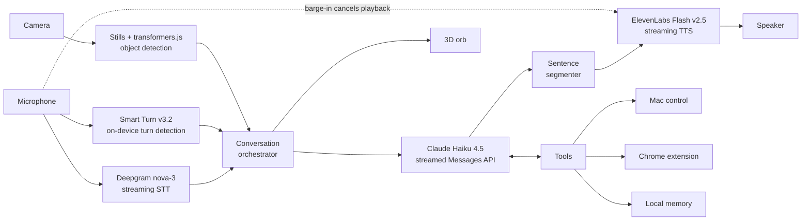

# Cipher

**A real-time voice agent that can see.** Cipher holds a natural spoken conversation on top of Claude, watches the camera with live on-device object detection, and takes actions on your Mac and in Chrome, with a human approval step before anything changes.

<!-- TODO: replace with a 20–30 second demo GIF or video link. This is the single most important thing on the page. -->


---

## Why this project exists

Most voice assistants feel like walkie-talkies: you speak, wait, and get a monologue back. Cipher is an attempt to close the gap between that and talking to a person. The engineering work is concentrated in four places:

1. **Latency.** Every stage streams, so Cipher starts speaking while Claude is still writing.
2. **Turn-taking.** A dedicated model decides whether you have finished or are only pausing, and Cipher yields within about 200 ms when you interrupt.
3. **Sight.** Voice and vision run in the same conversation: hold something up and ask about it, without typing or uploading anything.
4. **Safe action-taking.** Cipher can operate the computer and the browser, but it asks before any change, send, or purchase.

## Capabilities

| Area | What Cipher does |
| --- | --- |
| **Conversation** | Full-duplex speech with streaming transcription, streamed reasoning, and sentence-level speech synthesis |
| **Turn detection** | Semantic end-of-turn detection, so a mid-thought "um..." is not treated as the end of a turn |
| **Barge-in** | Start talking while Cipher is speaking and it goes quiet within about 200 ms |
| **Active listening** | Short backchannels ("mm-hmm", "oh wow", a soft laugh) in the gaps of longer turns; your own "yeah" does not cut it off; simultaneous starts are resolved with "sorry, go ahead" |
| **Memory** | Remembers you between conversations, stored only on the local machine |
| **Mac control** | Opens apps, manages files, runs commands, and reads the screen, asking before changing anything |
| **Chrome control** | Through the included extension: checks email, reads and operates websites, asking before sending or buying |
| **Vision** | Camera stills passed to Claude, plus live on-device object detection |
| **Interface** | A 3D orb that reacts to Claude's mood, each word spoken by either side, and the audio of both voices |

## Vision

Most voice agents are audio-only. Cipher adds a camera and runs sight on two tiers:

- **Live object detection, on-device.** A detection model runs in the browser through transformers.js, labelling what is in frame in real time. No video leaves the machine for this tier.
- **Camera stills to Claude.** When the conversation calls for real understanding, a still frame goes to Claude alongside the spoken question, so "what is this?" or "read this label for me" works by voice alone.

Splitting the work this way keeps the continuous part cheap, private, and fast, and reserves the large model for the moments that need it.

<!-- TODO: add a screenshot of the camera view with detection boxes. -->

## Architecture



### Pipeline

| Stage | Technology | Role |
| --- | --- | --- |
| Speech-to-text | Deepgram streaming (`nova-3`) | Interim results and end-of-turn signals |
| Turn detection | [Smart Turn v3.2](https://huggingface.co/pipecat-ai/smart-turn-v3) (open model, 8 MB, runs locally) | Distinguishes a finished turn from a pause |
| Reasoning | Anthropic Messages API, streamed (`claude-haiku-4-5` by default) | Response generation and tool use |
| Text-to-speech | ElevenLabs streaming (`eleven_flash_v2_5`) | One request per sentence, sent as soon as the sentence is written |
| Vision | Camera stills + [transformers.js](https://huggingface.co/docs/transformers.js) | Scene understanding and live object detection in the browser |

## Design decisions

**Sentence-level speech synthesis.** Waiting for the full response before synthesizing adds the entire generation time to perceived latency. Cipher segments the token stream into sentences and dispatches each to TTS the moment it completes, so audio begins after the first sentence rather than the last.

**The fastest model by default.** In voice, time to first token matters more than peak reasoning depth for most turns. Haiku is the default because it starts talking soonest; the model is configurable for heavier tasks.

**Turn detection as its own model.** Silence timers force a trade-off: short timeouts interrupt people mid-thought, long ones make the agent feel slow. Running a small audio model locally lets Cipher respond quickly after a real end of turn while staying quiet through hesitations, with no added network hop.

**Interruption as a first-class path.** Barge-in cancels playback and in-flight generation rather than letting the response finish, and backchannels from the user are filtered so they do not count as interruptions.

**Human in the loop for actions.** Read-only operations run freely. Anything that modifies files, executes commands, sends a message, or spends money is surfaced for confirmation first.

**Local-first data.** Conversation memory stays on the machine, and turn detection and object detection run on-device.

## Getting started

<!-- TODO: confirm these commands and variable names against the repo before publishing. -->

**Requirements:** macOS, a desktop Chromium browser, and API keys for Anthropic, Deepgram, and ElevenLabs.

```bash
git clone https://github.com/<your-username>/<repo-name>.git
cd <repo-name>
npm install
cp .env.example .env   # add your API keys
npm start
```

Then open `http://localhost:3000` and allow microphone access.

```ini
ANTHROPIC_API_KEY=
DEEPGRAM_API_KEY=
ELEVENLABS_API_KEY=
```

To enable browser control, load the included extension from `chrome://extensions` with Developer Mode on.

## Roadmap

- Background task execution, so long-running work does not block the conversation
- Delegation of heavy tasks to a remote server
- Outbound phone calls and a messaging channel
- Further latency reduction across the pipeline

## Built with

Claude (Anthropic) · Deepgram · ElevenLabs · Smart Turn · transformers.js

## Author

**Kiaan Hiranandani** · [LinkedIn](https://linkedin.com/in/kiaan-hira)

<!-- TODO: add a LICENSE file and name the license here. -->
